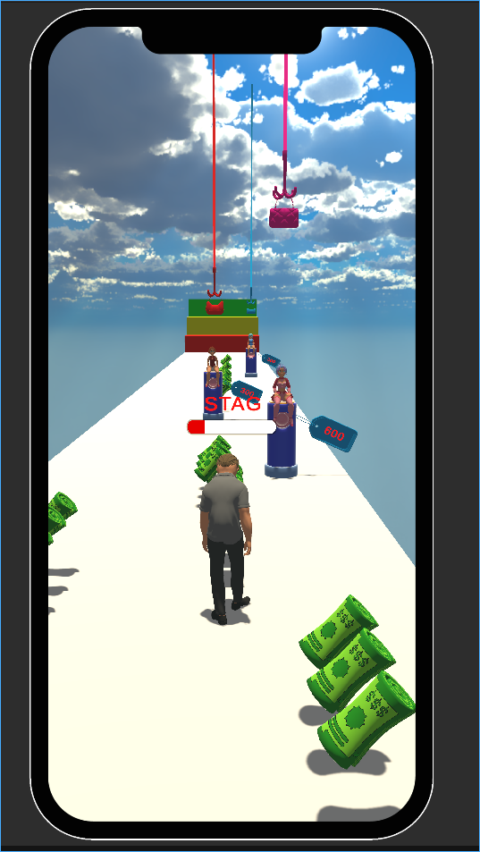
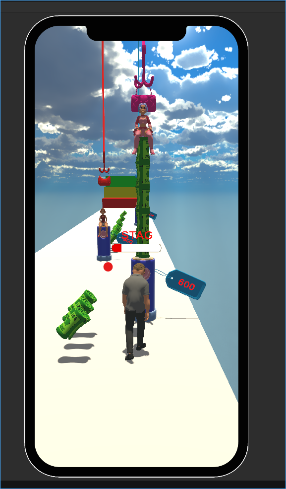
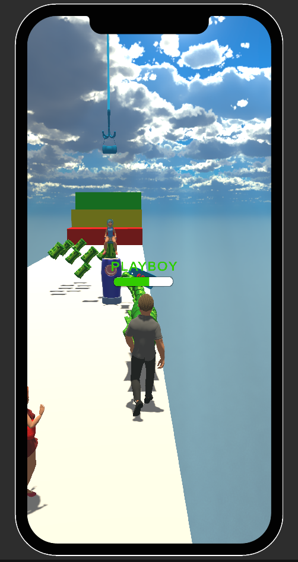
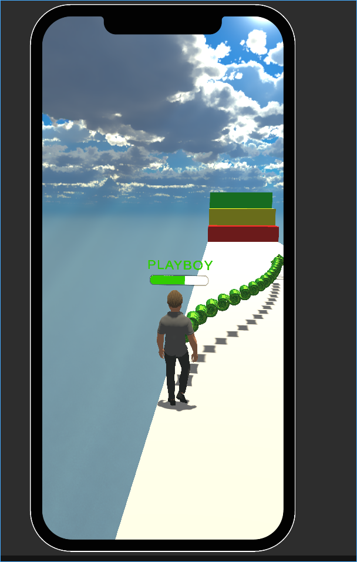
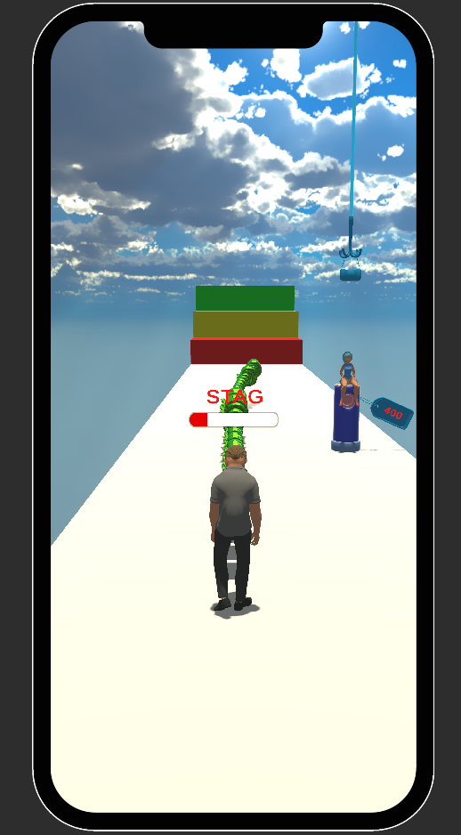
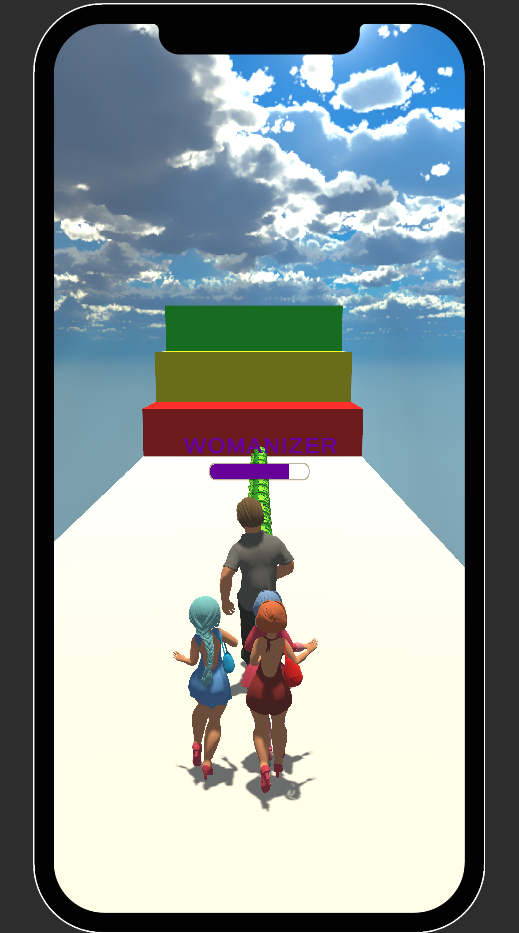
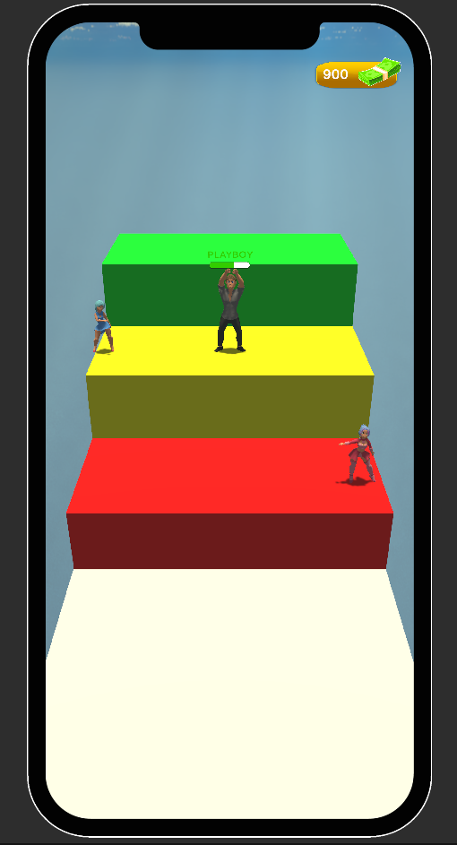

# RichieRich

Koşarken para toplanan, toplanan parayla çanta satın alınıp yanına takipçi toplanan bir mobil koşu oyunu.

## Neden?

Toplanan paranın yığın hâlinde karakterin önünde taşındığı, engelde kaybedildiği ve sonunda harcandığı bir koşu oyunu ekonomisini; paranın sallanma ve süzülme efektleriyle birlikte denemek için yapıldı.

## Oynanış

- Karakter koşarken para topluyor, para önünde yığın olarak taşınıyor.
- Yeterli para varsa yoldaki makineye para verilip çanta satın alınıyor.
- Çanta verilen karakterler takipçi olup oyuncunun peşinden geliyor.
- Para ya da karakter bir engele çarparsa engelin ötesindeki paralar kaybediliyor.
- Bölüm sonunda para hesaba yatırılıyor. Takipçi sayısı seviyeyi belirliyor, oyuncu seviyesine göre bitişteki merdivende yükseliyor.

## Ekranlar

| Çanta satın alma | Yeni takipçi |
|---|---|
|  |  |
| **Paranın süzülme efekti** | **Paranın sallanma efekti** |
|  |  |
| **Takipçiler** | **Bitiş** |
|  |  |

## Teknik

| | |
|---|---|
| **Motor** | Unity |
| **Kullanılanlar** | NavMesh Agent, DOTween, swerve kontrolü, nesne havuzu |
| **Bu repoda** | Yalnızca oyunun scriptleri (`Kodlar`) ve ekran görüntüleri (`Images`); Unity projesinin tamamı yok |
| **GitHub'a yükleme** | Şubat 2023 |
